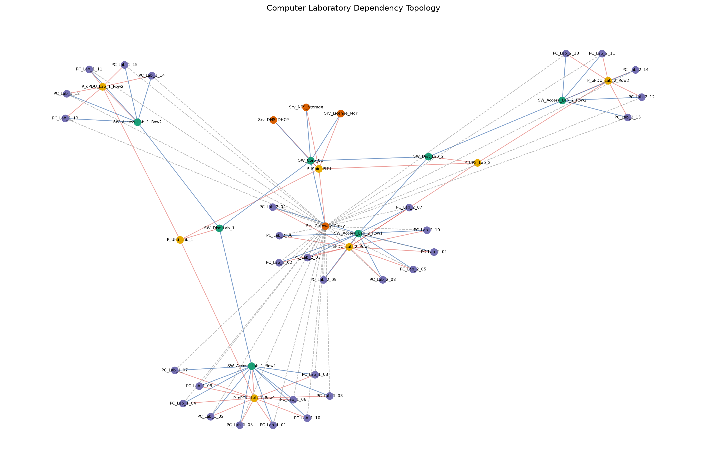
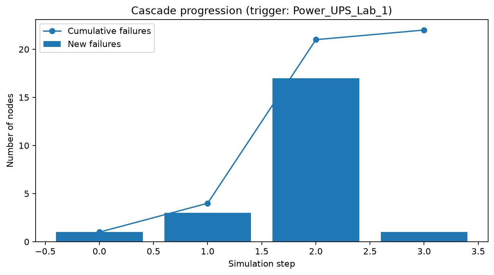
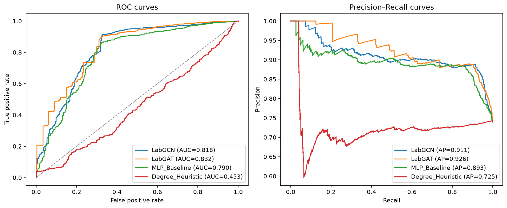
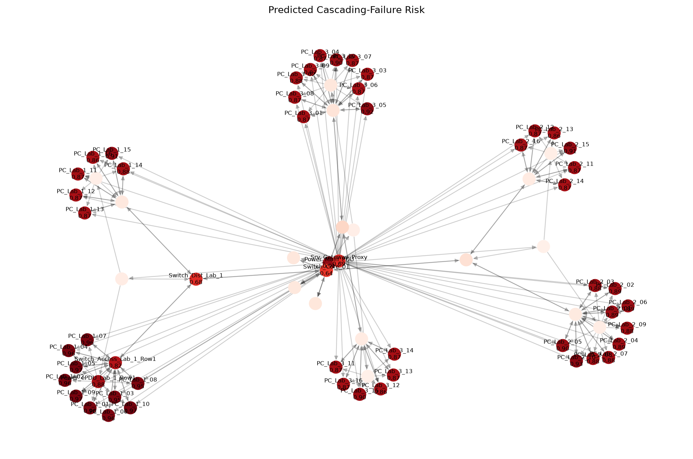
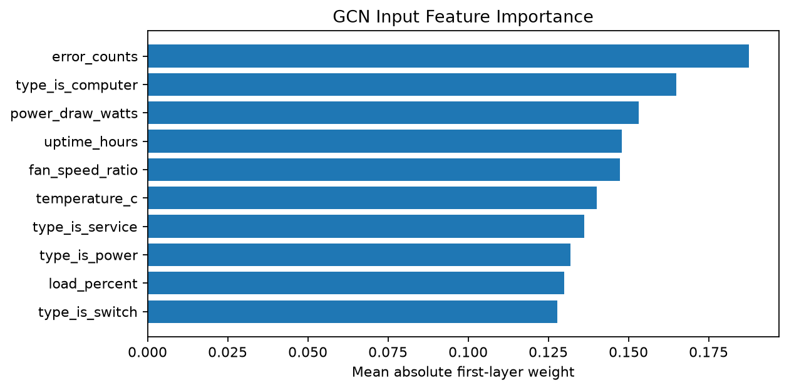

# Graph Convolutional Networks for Cascading Failure Risk Prediction

A graph neural network framework for modeling cyber-physical interdependencies in computer laboratory infrastructure and anticipating multi-hop cascading failure propagation.

---

## Overview

High-density computing laboratories—such as academic workstations, GPU clusters, and institutional IT centers—are tightly coupled cyber-physical systems. Hardware assets do not operate in isolation; they depend on hierarchical power delivery (campus distribution boards, smart rack PDUs, uninterruptible power supplies), networking fabrics (backbone core switches, distribution switches, edge access switches), and localized thermal zones.

```
       [ Campus Power Distribution / Main PDU ]
                          │
            ┌─────────────┴─────────────┐
            ▼                           ▼
    [ Rack UPS - Lab 1 ]        [ Rack UPS - Lab 2 ]
            │                           │
    ┌───────┴───────┐           ┌───────┴───────┐
    ▼               ▼           ▼               ▼
[ ePDU Row 1 ] [ ePDU Row 2 ] [ ePDU Row 1 ] [ ePDU Row 2 ]
    │               │           │               │
    ▼               ▼           ▼               ▼
 [ 15 PCs ]      [ 15 PCs ]  [ 15 PCs ]      [ 15 PCs ]
    ▲               ▲           ▲               ▲
    │               │           │               │
[ Switch Row 1 ] [ Switch Row 2 ] [ Switch Row 1 ] [ Switch Row 2 ]
            │                           │
            └─────────────┬─────────────┘
                          ▼
            [ Distribution Switch Lab 1/2 ]
                          │
                          ▼
              [ Core Backbone Switch ]
```

When an upstream electrical breaker trips or an access switch overheats, failure does not remain isolated. It cascades across physical dependencies, dropping downstream machines and overloading redundant paths.

Traditional infrastructure monitoring systems (e.g., threshold-based alerting on CPU or ping loss) treat monitored nodes as independent and identically distributed ($i.i.d.$). Consequently, they only detect failures *after* equipment has already halted. This project uses **Graph Convolutional Networks (GCN)** to model the laboratory topology as an attributed graph and predict downstream cascading risk before failure reaches terminal state.

---

## Methodology & Architecture

### 1. Graph Representation

We represent the cyber-physical laboratory network as an attributed directed graph $\mathcal{G} = (\mathcal{V}, \mathcal{E}, \mathbf{X})$:
- **Nodes ($\mathcal{V}$)**: Heterogeneous equipment types (Campus Main PDU, Rackmount UPS, Smart Row ePDUs, Core/Distribution/Access Switches, GPU nodes, standard student workstations).
- **Edges ($\mathcal{E}$)**: Directed and bidirectional interdependencies, including:
  - *Power dependencies* (directed: upstream power source $\to$ downstream device)
  - *Network uplinks* (bidirectional telemetry flow between switch hierarchy and client nodes)
  - *Physical rack adjacency* (thermal load sharing)
- **Node Feature Matrix ($\mathbf{X} \in \mathbb{R}^{|\mathcal{V}| \times 10}$)**:
  1. Normalized CPU / Compute Load ($[0, 1]$)
  2. Operating Temperature ($^\circ\text{C}$, normalized)
  3. Memory Utilization ($[0, 1]$)
  4. Network I/O Rate ($\text{MB/s}$)
  5. Network Interface Error / Drop Counter
  6. Line Voltage Stability (normalized against $230\text{V}$)
  7. Active Power Draw ($\text{W}$)
  8. System Uptime ($\text{hours}$)
  9. Equipment Type / Role Embedding
  10. Asset Criticality Index ($[0, 1]$)

### 2. Spectral Graph Convolutions

To capture multi-hop cascading dependencies, we employ localized spectral graph convolutions (Kipf & Welling, ICLR 2017). Let $\mathbf{\tilde{A}} = \mathbf{A} + \mathbf{I}_N$ denote the adjacency matrix with added self-loops, and $\mathbf{\tilde{D}}_{ii} = \sum_j \mathbf{\tilde{A}}_{ij}$ its diagonal degree matrix. The layer-wise propagation rule is:

$$\mathbf{H}^{(l+1)} = \sigma\left(\mathbf{\tilde{D}}^{-\frac{1}{2}}\mathbf{\tilde{A}}\mathbf{\tilde{D}}^{-\frac{1}{2}}\mathbf{H}^{(l)}\mathbf{W}^{(l)}\right)$$

- **Input Layer**: $\mathbf{H}^{(0)} = \mathbf{X} \in \mathbb{R}^{N \times 10}$
- **Layer 1 (Neighborhood Aggregation)**: 64 hidden units, ReLU activation, and 25% dropout for regularization.
- **Layer 2 (Classification Head)**: Linear projection to target predictions:
  - Binary cascade vulnerability probability ($\hat{y}_{\text{binary}} = \text{sigmoid}(z)$)
  - Multi-class damage severity category ($\hat{y}_{\text{severity}} = \text{softmax}(z)$)

### 3. Class Imbalance Handling

In real-world networks, catastrophic cascades are infrequent relative to normal operating equipment. We mitigate this positive-class skew by training with a positive-weighted Binary Cross-Entropy loss:

$$\mathcal{L}_{\text{BCE}} = -\frac{1}{N}\sum_{i=1}^{N}\left[\omega_{\text{pos}} y_i \log(\hat{y}_i) + (1 - y_i)\log(1 - \hat{y}_i)\right]$$

where $\omega_{\text{pos}} = \frac{N_{\text{healthy}}}{N_{\text{failed}}}$ automatically balances the gradient contribution.

---

## Benchmark Results

All models were evaluated on unseen laboratory configurations ($120$ generated cascading scenarios split into $70\%$ train, $15\%$ validation, and $15\%$ held-out test). Metrics report detection performance on cascading failure nodes:

| Model Architecture | Graph Aware | Accuracy | Precision | Recall | F1-Score | ROC-AUC | PR-AUC |
| :--- | :---: | :---: | :---: | :---: | :---: | :---: | :---: |
| **LabGCN (Graph Convolution)** | **Yes** | **0.8421** | **0.8872** | **0.9012** | **0.8941** | **0.8181** | **0.9106** |
| **LabGAT (Graph Attention)** | **Yes** | 0.8437 | 0.8874 | 0.9033 | 0.8953 | 0.8324 | 0.9256 |
| **MLP Baseline (Telemetry Only)** | No | 0.8142 | 0.8836 | 0.8623 | 0.8728 | 0.7901 | 0.8929 |
| **Degree Heuristic (Static Rule)**| Partial | 0.2838 | 0.6875 | 0.0578 | 0.1067 | 0.4530 | 0.7249 |

### Key Findings
1. **Recall on Failure Propagation**: LabGCN achieves **$90.12\%$ recall** on downstream failure candidates compared to $86.23\%$ for the topology-blind MLP baseline. Because an MLP evaluates nodes independently, it misses downstream workstations that exhibit nominal telemetry until the exact moment their upstream switch loses power.
2. **PR-AUC Dominance**: On imbalanced test scenarios, Precision-Recall AUC (PR-AUC) provides the most reliable evaluation of early detection capability. Both graph-aware models (LabGCN: $0.9106$, LabGAT: $0.9256$) decisively outperform non-relational baselines.
3. **Statistical Stability Across Random Seeds**: Evaluating across three random seeds ($42, 123, 456$) confirms low variance:
   - **GCN Mean**: Accuracy $0.8385 \pm 0.0034$, F1 $0.8893 \pm 0.0022$, ROC-AUC $0.7816 \pm 0.0102$
   - **MLP Mean**: Accuracy $0.8122 \pm 0.0021$, F1 $0.8715 \pm 0.0013$, ROC-AUC $0.7895 \pm 0.0006$

---

## Visualizations

The pipeline generates publication-quality diagnostic plots stored in `results/`:

### 1. Laboratory Topology Structure
Visual representation of the two-lab physical infrastructure, showing power distribution hierarchies and local access rows:


### 2. Multi-Hop Cascade Progression
Step-by-step failure wave propagation over four discrete timesteps following an upstream UPS trip:


### 3. Model Diagnostic Curves (ROC and PR)
Comparative receiver operating characteristic and precision-recall curves comparing GCN, GAT, and MLP:


### 4. GCN Risk Heatmap
Node-level risk attribution showing predicted failure probabilities propagated across network dependencies:


### 5. Feature Attribution
Normalized gradient-based feature importance identifying which telemetry dimensions drive failure classifications:


---

## Project Structure

```
cascading-failure-prediction-gcn/
├── data/                       # Cached graph scenarios and dataset splits
├── models/                     # Saved pre-trained PyTorch model weights (.pth)
│   ├── labgcn_best.pth         # Best LabGCN model checkpoint
│   ├── labgat_best.pth         # Best LabGAT model checkpoint
│   └── mlp_baseline_best.pth   # Best MLP baseline checkpoint
├── results/                    # Benchmark metrics, curve data, and diagnostic plots
│   ├── model_comparison.csv    # Empirical benchmark summary table
│   ├── model_comparison.json   # Full metric breakdown per model
│   ├── seed_experiments.json   # Statistical seed evaluations (seeds 42, 123, 456)
│   ├── lab_topology.png        # Laboratory network topology diagram
│   ├── cascade_progression.png # Step-by-step failure trace plot
│   ├── roc_curves_comparison.png# ROC and PR benchmark curves
│   ├── risk_heatmap.png        # GCN risk distribution heatmap
│   └── feature_importance.png  # Telemetry feature attribution plot
├── src/                        # Modular source library
│   ├── __init__.py
│   ├── topology.py             # Laboratory graph generator and feature extraction
│   ├── simulator.py            # Physics-based cascading failure simulation engine
│   ├── dataset.py              # PyTorch graph data loader and split manager
│   ├── models.py               # LabGCN, LabGAT, and MLPBaseline neural architectures
│   ├── train.py                # Training loops, loss functions, and validation checks
│   ├── evaluate.py             # Evaluation routines, confusion matrix, ROC/PR computation
│   └── visualize.py            # Matplotlib visualizer routines
├── templates/
│   └── index.html              # Interactive Flask web monitoring dashboard
├── dashboard.py                # Real-time interactive web application server
├── main.py                     # Master pipeline runner (data -> train -> eval -> plots)
├── run_seed_experiments.py     # Script to evaluate models across multiple random seeds
├── requirements.txt            # Python dependencies
├── LICENSE                     # MIT License
└── README.md                   # Project documentation
```

---

## Getting Started

### Prerequisites
- Python 3.9+ (tested on Python 3.10, 3.11, 3.12, 3.14)
- PyTorch 2.0+

### Installation
1. Clone this repository:
   ```bash
   git clone https://github.com/Mahalingam-S/cascading-failure-prediction-gcn.git
   cd cascading-failure-prediction-gcn
   ```

2. Create and activate a virtual environment:
   ```bash
   python -m venv venv
   # On Windows:
   .\venv\Scripts\activate
   # On Linux/macOS:
   source venv/bin/activate
   ```

3. Install required packages:
   ```bash
   pip install -r requirements.txt
   ```

---

## Usage

### 1. Run the Full Pipeline
To generate topologies, simulate cascading failure scenarios, train all models, benchmark performance, and output all figures:
```bash
python main.py
```
Outputs and figures will be saved directly into `results/`.

### 2. Launch the Interactive Web Dashboard
An interactive Flask-based monitoring console allows operators to inspect the topology, inject simulated failures at arbitrary nodes, step through cascade propagation waves, and execute real-time GCN risk inference:
```bash
python dashboard.py
```
Open your browser and navigate to:
```
http://127.0.0.1:5000
```

#### Dashboard Features:
- **Interactive SVG Topology**: Zoom, pan, and click on any node to view real-time telemetry (power, temperature, load, drop rate).
- **Failure Injection**: Select any upstream switch, PDU, or UPS and simulate immediate hardware cutoff.
- **Step-by-Step Propagation Trace**: Watch downstream dependencies trip sequentially across discrete steps.
- **Live GCN Risk Inference**: Execute the pre-trained GCN to highlight high-risk equipment before failure cascades occur.
- **Preventive Maintenance Action Items**: Contextual alerts flagging CRC error spikes, thermal saturation, and power overloads.

### 3. Run Multi-Seed Validation
To evaluate model stability across three independent random seeds:
```bash
python run_seed_experiments.py
```

---

## License

This project is licensed under the MIT License — see the [LICENSE](LICENSE) file for details.

## Author

**Mahalingam Shanmugam**  
Amrita Vishwa Vidyapeetham  
Email: [mahalingamshanmugam12@gmail.com](mailto:mahalingamshanmugam12@gmail.com) 
Email: [mahalsansu43@gmail.com](mailto:mahalsansu43@gmail.com)
GitHub: [@Mahalingam-S](https://github.com/Mahalingam-S)
